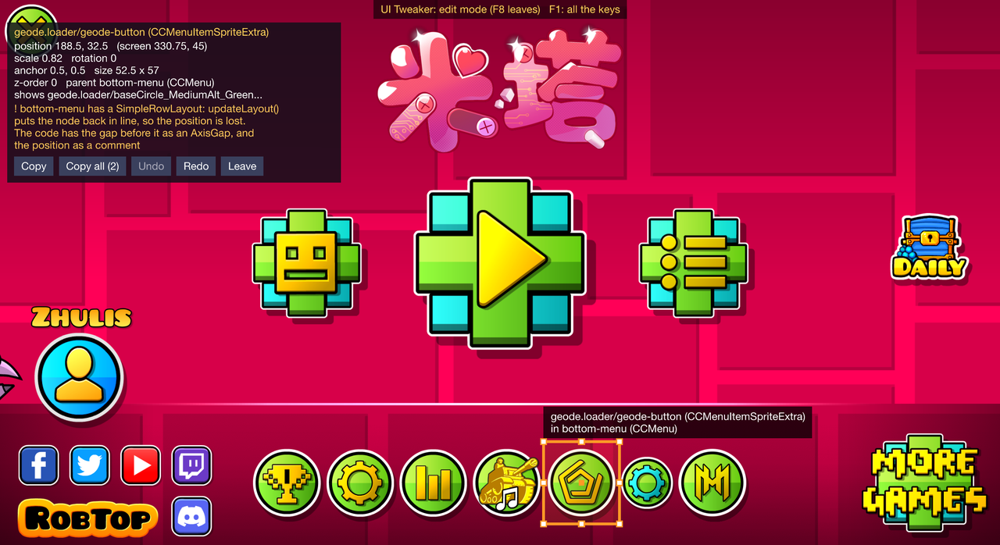

# UI Tweaker

A [Geode](https://geode-sdk.org) mod for Geometry Dash, for mod developers: move and scale any node of the game's interface with the mouse, right in the game, then copy the C++ that puts it there. Your buttons and popups in their places after one rebuild instead of five. Windows.




## Install

Download `zhulis.ui-tweaker.geode` from the newest of the [releases](https://github.com/ZhulinskiiDanil/ui-tweaker/releases) and put it into Geode's mods folder (or **Install from file** on Geode's mods page). Or, with [Zhulis Mods Manager](https://github.com/ZhulinskiiDanil/zhulis-mods-manager), turn on its **Include pre-releases** setting: the mod is a beta, its releases are pre-releases.

## Use

`F8` (a setting) turns the edit mode on and off, in any scene. While it's on, the game gets no clicks and no keys but its own toggle:

| | |
| --- | --- |
| Hover | A box around the topmost node under the mouse, its class (from RTTI), its ID and its parent |
| Click | Selects it: an orange box, its anchor point, and the panel with its position, scale, anchor point, size, parent and z-order, and why it may not move or show: its parent's layout, running actions, an invisible parent, opacity or scale 0, no content size, an ignored anchor point, a clipping parent, being off the screen |
| Drag | Moves it. A turned, scaled or flipped parent is taken into account: the node follows the mouse. Its edges and center snap to the screen's, the parent's and the siblings' within 3 points, with the guides drawn (`Ctrl`: no snapping; a setting) |
| Wheel | Scales it by 10% a notch, `Shift`: by 0.01 |
| Arrows | Moves it by 1 in its parent, `Shift`: by 10 |
| `Ctrl+Z`, `Ctrl+Y` | Undo, redo. A turn of the wheel or a run of arrow presses is one step |
| `Ctrl+C` | Copies the C++ for the selected node |
| `Ctrl+Shift+C` | Copies the C++ for every node edited in the scene, one block, a comment for each |
| `Alt` held | The distances from the selected node to the one under the mouse, as in Figma: the gaps between them, or from the inner one's edges to the outer one's |
| `Tab` | The next node under the mouse, deeper each time |
| `Alt`+click | A part of a button or a label, not the whole of it |
| `PgUp`, `PgDn` | The parent, the first child |
| `A` | Other screens: the 16:10, 4:3 and 21:9 screens drawn over this one, the selected node where it would be on each, a red box around every node with an ID that wouldn't fit on one of them. The panel says it too |
| `T` | The node tree of the scene at the right: every node with its ID and class, the hidden ones grey. A click on a row selects its node, the wheel scrolls it. `/` searches by ID and class (words in any order), `Enter` selects the first match |
| `H` | Hides the panel. Its title bar drags it |
| `Esc` | Unselects, then leaves the edit mode |

A button, a label or a 9-slice is picked as a whole: a click on the play button's sprite selects the button.


The edit mode speaks English and Russian (the *Language* setting; Auto follows Windows). GD's bitmap fonts have no Cyrillic, so in Russian its text is drawn with TTF labels, rendered again only when they change. The generated code is English either way.

## The code

```cpp
// geode.loader/geode-button (CCMenuItemSpriteExtra) in bottom-menu (CCMenu)
if (auto node = this->getChildByIDRecursive("geode.loader/geode-button"))
{
  auto winSize = CCDirector::get()->getWinSize();
  node->setPosition({winSize.width / 2 + 40.f, winSize.height - 25.f});
  node->setScale(1.2f);
}
```

- **Found by its ID** (Geode node IDs). Without one, through its parent's ID and `getChildByType`; without that either, the lines are for wherever you make the node
- **Relative to the closest edge or the center**, on each axis: of the screen when the parent is screen-sized and not scaled or turned (a layer, a menu as made), of the parent's content box otherwise (`parentSize.width - 10.f`). On a wider or narrower screen the node stays by the same edge
- **Layouts**: if the parent has one, the panel says what `updateLayout()` will do to the node. For an `AnchorLayout` the code is the anchor and the offset (`AnchorLayoutOptions`), for an `AxisLayout` (`RowLayout`, `ColumnLayout`) the gap before the node and `setAutoScale(false)` if it was scaled, for a `SimpleAxisLayout` an `AxisGap`; the position itself is then a comment
- Only what changed: the scale, the anchor point and the z-order are written if they differ from before the edits (the scale also when it isn't 1)

## Self test

`UI_TWEAKER_SELFTEST=1` at launch: in the main menu the mod turns the edit mode on and, with the same calls the mouse and the keys make, picks the play button, the Geode button and a label, drags each by (30, -20), turns the wheel, presses the arrows, generates the code and reads it back (it has to give the node's position exactly), then undoes everything and checks that every value is back, redoes and undoes again. The log ends with `Self test PASS: N checks` or the failures. `tools/check.sh` runs it, takes a screenshot of the game and prints the log's lines. `tools/real-input.sh` drives the edit mode with real mouse and keys (SendInput) and checks each step in the log; `tools/gif.sh` made the GIF above. `UI_TWEAKER_LANG=en` or `ru` overrides the language for screenshots.

## Build

```
geode build --ninja
```

The math has no Geode in it and is tested on its own:

```
cmake -S tests -B build-tests
cmake --build build-tests
ctest --test-dir build-tests
```

How it works: [docs/ARCHITECTURE.md](docs/ARCHITECTURE.md).
