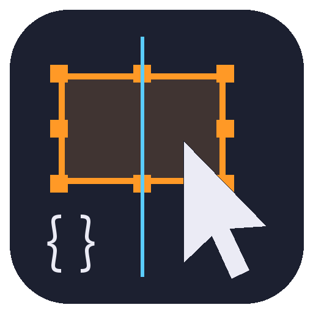
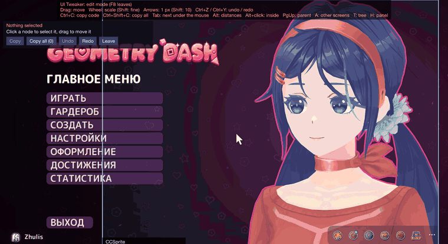
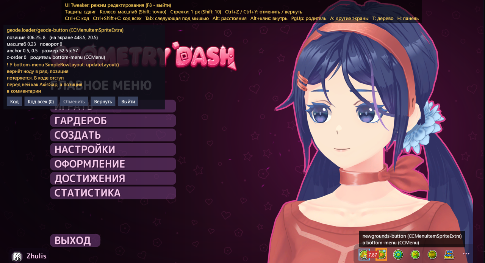
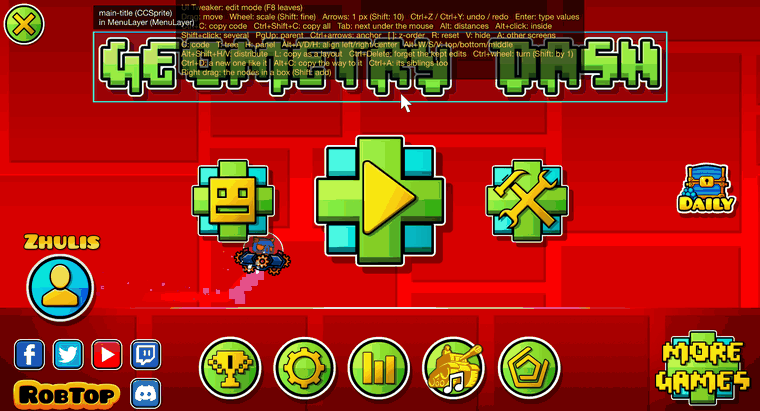
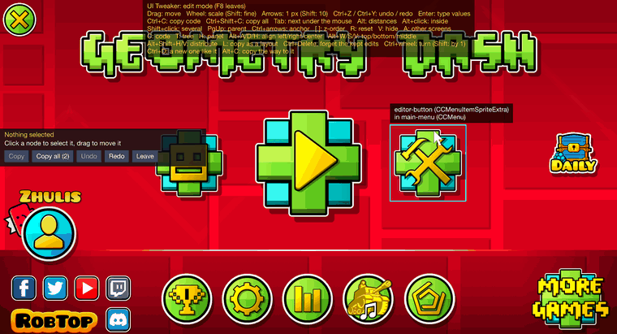
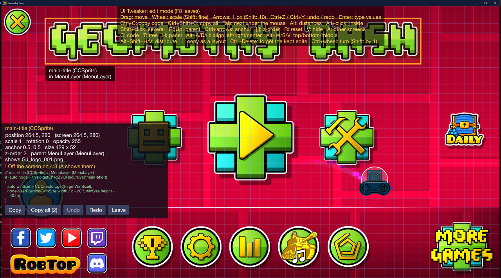

# UI Tweaker

[English](README.md)

Мод для [Geode](https://geode-sdk.org) (Geometry Dash) для разработчиков модов: двигайте и масштабируйте любую ноду интерфейса мышкой прямо в игре, потом скопируйте C++, который ставит её туда. Ваши кнопки и попапы встают на место за одну пересборку, а не за пять. Windows.













## Установка

Скачайте `zhulis.ui-tweaker.geode` из последнего [релиза](https://github.com/ZhulinskiiDanil/ui-tweaker/releases) и положите в папку модов Geode (или **Install from file** на странице модов Geode). Или через [Zhulis Mods Manager](https://github.com/ZhulinskiiDanil/zhulis-mods-manager) с включённой настройкой **Include pre-releases**: мод в бете, его релизы — pre-release.

## Как это выглядит в работе

1. В своём моде добавьте кнопку или попап куда угодно, с ID (`setID("my-button"_spr)`), и соберите один раз
2. В игре `F8`, перетащите её куда надо, колесом подберите масштаб, при желании `Enter` — точные значения; несколько нод (`Shift`+клик, рамка правой кнопкой или `Ctrl+A`) выровняйте через `Alt`+`A`/`D`/`H`/`W`/`S`/`V` или превратите в ряд через `L`; `A` покажет, помещается ли она на экранах 4:3 и 21:9. Кнопки ещё нет? `Ctrl+D` создаст такую же, как ванильная, — останется поставить
3. `Ctrl+Shift+C`: код для всего, что вы двигали или создали, в виде `$modify`-хуков тех слоёв, где оно лежит, и ещё в `export.cpp`. Вставьте строки в свой хук (или хук целиком), соберите: всё стоит там, куда вы поставили, на любом экране. Если перезапустить игру до вставки, правки сохранятся

## Как пользоваться

`F8` (настраивается) включает и выключает режим редактирования в любой сцене. Пока он включён, игра не получает ни кликов, ни клавиш, кроме самой `F8`:

| | |
| --- | --- |
| Наведение | Рамка вокруг самой верхней ноды под мышью, её класс (по RTTI), ID и родитель |
| Клик | Выбирает её: оранжевая рамка, anchor point и панель с позицией, масштабом, anchor point, размером, родителем и z-order, тем, что она показывает (имя кадра спрайта, шрифт и текст надписи), а ещё почему нода может не двигаться или не показываться: layout родителя, идущие action, невидимый родитель, прозрачность или масштаб 0, нулевой размер, игнорируемый anchor point, обрезающий родитель, нода за краем экрана |
| Перетаскивание | Двигает её. Повёрнутый, масштабированный или отражённый родитель учитывается: нода идёт за мышью. Края и центр примагничиваются к краям и центрам экрана, родителя и соседей в пределах 3 точек, с линиями-направляющими (`Ctrl` — без примагничивания; есть настройка). С настройкой *Сетка* (в точках) числа в коде идут шагами от ближайшего края или центра (`winSize.width / 2 - 20.f`), сетка видна при перетаскивании |
| Ручки | Восемь квадратиков на рамке выбранной ноды меняют её размер (размер контента), противоположная сторона остаётся на месте при любом anchor point, масштабе и повороте. Нода со своим layout сразу раскладывает детей |
| Колесо | Масштаб на 10% за щелчок, с `Shift` — на 0.01 |
| `Ctrl`+колесо | Поворот на 15 градусов за щелчок, с `Shift` — на 1 |
| Стрелки | Сдвиг на 1 в координатах родителя, с `Shift` — на 10 |
| `Enter` | Ввод точных значений: x, y, масштаб, ширина и высота (размер контента; нода со своим layout раскладывает детей в новом размере), поворот и непрозрачность (0–255), `Tab` — следующее, `Enter` — применить (один шаг отмены), `Esc` — отмена. Числа или выражения: `w / 2 + 40`, `h - 25` (`w`, `h` — экран; `pw`, `ph` — родитель). Если выбрано несколько нод, изменённые поля получают все они |
| `Ctrl`+стрелки | Переносит anchor point к следующему из 0, 0.5 и 1 в эту сторону, нода остаётся на месте на экране (позиция меняется вместе с ним) |
| `[`, `]` | z-order ниже, выше (в axis layout это порядок) |
| `R` | Вернуть ноду к виду до первой правки: один шаг отмены |
| `V` | Скрыть её (ненужную ванильную кнопку) или показать снова: в коде будет `setVisible(false)`. Скрытая нода остаётся в дереве (`T`) |
| `Ctrl+Z`, `Ctrl+Y` | Отменить, вернуть. Прокрутка колеса или серия нажатий стрелок — один шаг |
| `Ctrl+C` | Копирует C++ для выбранной ноды |
| `C` | Показывает этот код в панели, каким он будет сейчас: он меняется, пока вы тащите |
| `Ctrl+Shift+C` | Копирует C++ для всех изменённых нод, с комментарием у каждой: этой сцены и сцен, из которых вы ушли, по слою, в хук которого он идёт (ближайший родитель — слой, который моды хукают: `MenuLayer`, `PlayLayer`, `EditorUI`, `PauseLayer`… или верхний, например попап). Для таких слоёв это целый `$modify` с правильным `init` (или `customSetup`) — можно вставлять как есть. Ещё пишет его в `export.cpp` в папке сохранений мода. Правки хранятся между запусками игры (`session.txt` в папке сохранений), так что пересборка и перезапуск не теряют то, что ещё не вставлено |
| `Ctrl+Delete` | Забывает правки, сохранённые с других сцен и прошлых запусков |
| `Alt` зажат | Расстояния от выбранной ноды до ноды под мышью, как в Figma: промежутки между ними или от краёв внутренней до краёв внешней |
| `Tab` | Следующая нода под мышью, каждый раз глубже |
| `Alt`+клик | Часть кнопки или надписи, а не вся она |
| `Shift`+клик | Добавляет ноду к выбранным или убирает её. Перетаскивание, стрелки и колесо двигают их все, отмена — одним шагом; `Ctrl+C` копирует код для всех |
| `Ctrl+A` | Выбирает вместе с нодой её соседей (видимых, с размером): ряд кнопок меню, чтобы выровнять или `L` |
| Тащить правой кнопкой | Выбирает ноды, целиком попавшие в рамку; пока рамку тянут, они обведены (`Shift`: добавить к выбранным, `Esc`: без рамки). Щелчок правой кнопкой снимает выбор |
| `Alt+C` | Копирует только путь к выбранной ноде: её поиск (по ID, по пути, через родителя) вокруг пустого блока, где `node` — она, с приведением к её классу, для вашего собственного кода, которому она нужна |
| `Ctrl+D` | Создаёт ноду, как выбранная, рядом с ней в том же родителе: спрайт с её кадром, кнопку с её картинкой и собственным масштабом картинки (или текстом `ButtonSprite`, или `CircleButtonSprite` Geode с иконкой, цветом и размером основы), надпись с её текстом и шрифтом. Перетащите её на место; её код создаёт её (`createWithSpriteFrameName`, `CCMenuItemSpriteExtra::create` с вашим callback вместо `nullptr`, `addChild`) и ставит, как любую ноду. Отмена убирает её. Текстовая кнопка получает шрифт, фон, ширину и высоту оригинала, если её фон — отдельная текстура (как у кнопок GD), иначе вид `ButtonSprite` по умолчанию |
| `L` | Копирует выбранные ноды одного родителя как ряд или столбец: новое меню (или нода) с `RowLayout`/`ColumnLayout`, у которого промежуток, размер, позиция и выравнивание ставят их туда, где они сейчас, и код, который переносит их туда. Сначала выровняйте их через `Alt`; если промежутки разные, код об этом скажет |
| `Alt`+`A` `D` `H` / `W` `S` `V` | Выравнивает выбранные ноды на экране по левому краю, правому, центру / верху, низу, середине, как в Figma: несколько — по общей рамке, одну — по рамке родителя (или экрана). `Alt`+`Shift`+`H` / `V` делает одинаковые промежутки между тремя и более |
| `PgUp`, `PgDn` | Родитель, первый ребёнок |
| `A` | Другие экраны: рамки 16:10, 4:3 и 21:9 поверх этого, выбранная нода там, где она окажется на каждом, и красная рамка вокруг каждой ноды с ID, которая на каком-то из них не поместится. Панель тоже об этом говорит |
| `T` | Дерево нод сцены справа: каждая нода с ID и классом, скрытые — серым. Клик по строке выбирает ноду, колесо листает. `/` — поиск по ID, классу и тому, что нода показывает, кадру или тексту (слова в любом порядке), `Enter` выбирает первое совпадение |
| `H` | Прячет панель. Её заголовок можно тащить |
| `F1` | Все клавиши в баннере сверху (иначе он в одну строку и не мешает тому, что наверху) |
| `Esc` | Снимает выбор, потом выходит из режима |

### Настройки

| | |
| --- | --- |
| Режим редактирования | Клавиша включения и выключения, по умолчанию `F8`; работает и в текстовых полях |
| Примагничивание | Края и центры прилипают к краям и центрам экрана, родителя и соседей (вкл.) |
| Сетка | Числа в коде перетаскиваемой ноды идут шагами в столько точек от ближайшего края или центра, сетка видна при перетаскивании (0 — нет) |
| Возвращать правки | Пока режим включён, заново созданный экран или игра после перезапуска получают свои сохранённые правки (выкл.) |
| Язык | Авто, английский или русский |
| Стиль кода | Скобки на своих строках и 2 пробела или K&R и 4 |
| Закрепление в Improved Logger | Выбранная нода и число правок закреплены в его консоли, если он установлен |

Кнопка, надпись или 9-slice выбираются целиком: клик по спрайту кнопки «играть» выбирает саму кнопку.

Режим говорит по-русски и по-английски (настройка *Language*; Auto — как в Windows). В растровых шрифтах GD нет кириллицы, поэтому по-русски текст рисуется TTF-надписями, которые перерисовываются только при изменении. Сгенерированный код в любом случае на английском.

## Код

```cpp
// geode.loader/geode-button (CCMenuItemSpriteExtra) in bottom-menu (CCMenu)
if (auto node = this->getChildByIDRecursive("geode.loader/geode-button"))
{
  auto winSize = CCDirector::get()->getWinSize();
  node->setPosition({winSize.width / 2 + 40.f, winSize.height - 25.f});
  node->setScale(1.2f);
}
```

- **По ID** (Geode node IDs), если раньше него в слое нет другой ноды с тем же ID. Без ID — вниз от ближайшего родителя с ID (или от самого слоя), каждый шаг — по ID ребёнка, по кадру спрайта или кнопки или через `getChildByType`; когда такой путь хрупкий, код об этом пишет
- **От ближайшего края или центра** по каждой оси: экрана, если родитель размером с экран и не масштабирован и не повёрнут (слой, меню как есть), иначе прямоугольника родителя (`parentSize.width - 10.f`). На более широком или узком экране нода остаётся у того же края
- **Layout**: если у родителя он есть, панель говорит, что с нодой сделает `updateLayout()`. Для `AnchorLayout` код — это якорь и смещение (`AnchorLayoutOptions`; если они у ноды уже есть, якорь сохраняется, меняется только смещение), для `AxisLayout` (`RowLayout`, `ColumnLayout`) — отступ перед нодой и `setAutoScale(false)`, если её масштабировали, для `SimpleAxisLayout` — `AxisGap`; сама позиция тогда в комментарии
- **Оформление**: фигурные скобки на своих строках и 2 пробела, или K&R с 4 пробелами (настройка *Code style*)
- Только то, что изменилось: масштаб, anchor point, z-order и размер контента (с `updateLayout()` для ноды со своим layout) пишутся, если отличаются от того, что было до правок (масштаб — ещё и когда он не 1). z-order пишется и для нод в layout: там это их порядок

## Самопроверка

`UI_TWEAKER_SELFTEST=1` при запуске (`play` — потом ещё в первый уровень и правка надписи процентов там, `editor` — в редактор уровней с 3000 объектами и правка кнопки build, `tour` — пройти тринадцать сцен игры (главное меню, меню создания, гардероб, главные уровни, поиск, ваши уровни, страница уровня, простой попап, настройки, ещё настройки, ваш профиль, уровень и его пауза), в каждой перетащить то, что под сеткой точек, прочитать его код обратно и отменить, `aspect` — оставить рамки других экранов, `code` — показ кода, `grid` — перетаскивание по сетке; `reload` перезагружает игру при включённом режиме, `session` возвращает сохранённые правки на заново созданное главное меню, `ime` оставляет текстовое поле в фокусе для настоящего F8, `limit` проходит за 200 шагов истории). В главном меню мод включает режим редактирования и теми же вызовами, что мышь и клавиши, выбирает кнопку «играть», кнопку Geode и надпись, тащит каждую на (30, -20), крутит колесо, жмёт стрелки, генерирует код и читает его обратно (он должен давать ровно позицию ноды), отменяет всё и проверяет, что все значения вернулись, возвращает и снова отменяет. Дальше примагничивание, anchor point и z-order, расстояния; 5000 спрайтов в сцене — сколько стоят наведение и дерево (около 2.4 мс на наведение, меньше 1 мс за кадр на дерево); удаление выбранной ноды, которая ещё и под мышью, и в дереве; две смены сцены с выбранной нодой; попап Geode, кнопку которого тащат и дают ей сгенерированные AnchorLayoutOptions — после `updateLayout()` она должна остаться там; ввод значений клавишами. Лог заканчивается строкой `Self test PASS: N checks` или списком провалов. `tools/check.sh` запускает её, снимает скриншот игры и печатает строки лога. `tools/real-input.sh` водит режим редактирования настоящими мышью и клавишами (SendInput) и проверяет каждый шаг по логу; `tools/gif.sh` записал GIF выше. `UI_TWEAKER_LANG=en` или `ru` задаёт язык для скриншотов. `tools/vanilla.sh <проверка>` запускает любую из них в ванильной игре (всё, кроме Geode и node-ids, выключено на время и потом возвращено); `tools/session-check.sh` перезапускает игру с настоящим вводом и проверяет возврат правки; `tools/codecheck.sh` компилирует сгенерированный код против настоящих заголовков Geode; `tools/e2e.sh` проверяет всё, ради чего мод: правка главного меню, её «Код всех», собранный в отдельный мод, один запуск игры с ним — ноды там, где их оставила правка; `tools/soak.sh` следит за памятью.

## Сборка

```
geode build --ninja
```

Математика без Geode тестируется отдельно:

```
cmake -S tests -B build-tests
cmake --build build-tests
ctest --test-dir build-tests
```

`tools/codecheck.sh` компилирует весь генерируемый код против настоящих заголовков Geode (CI тоже), а `tools/e2e.sh` проверяет всё в игре: «Код всех» после правки, собранный в отдельный мод, ставит ноды туда, где их оставила правка.

Как это устроено: [docs/ARCHITECTURE.md](docs/ARCHITECTURE.md).
